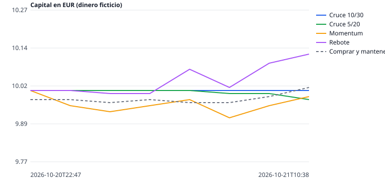

# Oficina de agentes (dinero ficticio)

Ultima actualizacion: 2026-10-21T10:38:18+00:00 UTC · Precio BTC/EUR: 74136 (Kraken)
En marcha desde: 2026-10-20T22:47:24+00:00 UTC (0.5 dias)
Monedas vigiladas: las 20 de mayor volumen contra EUR (con datos en esta ejecucion: 20) · cada agente puede tener hasta 5 a la vez, 2.00 EUR en cada una
Costes simulados por operacion: comision 0.25 % + deslizamiento 0.05 % (0.3 % en monedas de poco volumen) · limite de perdida diaria: 0.40 EUR

| Agente | Capital (EUR) | Resultado (EUR) | Resultado (%) | Dif. vs Comprar y mantener (EUR, desde su inicio) | Operaciones | Desde | Estado |
|---|---:|---:|---:|---:|---:|---|---|
| Cruce 10/30 | 10.00 | +0.00 | +0.00 % | -0.01 | 0 | 2026-10-20 | En efectivo |
| Cruce 5/20 | 9.97 | -0.03 | -0.32 % | -0.04 | 2 | 2026-10-20 | Con ARB, TIA |
| Momentum | 9.98 | -0.02 | -0.18 % | -0.03 | 7 | 2026-10-20 | Con ETH, LTC, XBT, XRP, ZEC |
| Rebote | 10.12 | +0.12 | +1.22 % | +0.11 | 5 | 2026-10-20 | Con XMR |
| Cruce 10/30 + filtro | 10.00 | +0.00 | +0.00 % | -0.01 | 0 | 2026-10-20 | En efectivo |
| Consenso 2 de 3 | 9.95 | -0.05 | -0.53 % | -0.06 | 3 | 2026-10-20 | Con PEPE |
| Cruce 3/8 rapido | 9.82 | -0.18 | -1.78 % | -0.18 | 17 | 2026-10-20 | Con NEAR, PUMP, TIA, XBT, XRP |
| Momentum rapido | 9.85 | -0.15 | -1.54 % | -0.16 | 15 | 2026-10-20 | Con PUMP, SOL, TIA, XBT, XRP |
| Rebote rapido | 10.01 | +0.01 | +0.07 % | +0.00 | 15 | 2026-10-20 | Con COMP, INJ, ZRO |
| Comprar y mantener (solo BTC) | 10.01 | +0.01 | +0.08 % | 0.00 | 1 | 2026-10-20 | Referencia |

Riesgo (calculado con el historial guardado):

| Agente | Caida maxima | Operaciones ganadoras | Operaciones perdedoras |
|---|---:|---:|---:|
| Cruce 10/30 | 0.00 % | 0 | 0 |
| Cruce 5/20 | -0.30 % | 0 | 0 |
| Momentum | -0.90 % | 0 | 1 |
| Rebote | -0.60 % | 2 | 0 |
| Cruce 10/30 + filtro | 0.00 % | 0 | 0 |
| Consenso 2 de 3 | -0.50 % | 0 | 1 |
| Cruce 3/8 rapido | -1.80 % | 0 | 6 |
| Momentum rapido | -1.50 % | 0 | 5 |
| Rebote rapido | -0.90 % | 3 | 3 |
| Comprar y mantener | -0.10 % | 0 | 0 |

Caida maxima = lo que llego a perder cada agente desde su mejor momento. Una operacion cuenta cuando se cierra con su venta.

⚠ Aun sin datos suficientes (se exigen 30 operaciones cerradas y 21 dias): Cruce 10/30 (0 cerradas, 0 dias); Cruce 5/20 (0 cerradas, 0 dias); Momentum (1 cerradas, 0 dias); Rebote (2 cerradas, 0 dias); Cruce 10/30 + filtro (0 cerradas, 0 dias); Consenso 2 de 3 (1 cerradas, 0 dias); Cruce 3/8 rapido (6 cerradas, 0 dias); Momentum rapido (5 cerradas, 0 dias); Rebote rapido (6 cerradas, 0 dias). Antes de eso, el resultado puede ser pura suerte.

Aviso: solo hay 0.5 dias de datos; aun no hay base para concluir que una estrategia sea mejor.

Una estrategia solo merece dinero real si supera de forma sostenida a 'Comprar y mantener' durante semanas.
Probar muchas monedas y estrategias aumenta la probabilidad de que alguna parezca buena solo por casualidad.
Estos resultados no garantizan beneficios futuros.
