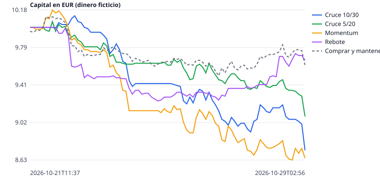

# Oficina de agentes (dinero ficticio)

Ultima actualizacion: 2026-10-22T07:37:36+00:00 UTC · Precio BTC/EUR: 73135 (Kraken)
En marcha desde: 2026-10-21T11:37:53+00:00 UTC (0.8 dias)
Monedas vigiladas: las 20 de mayor volumen contra EUR (con datos en esta ejecucion: 20) · cada agente puede tener hasta 5 a la vez, 2.00 EUR en cada una
Costes simulados por operacion: comision 0.40 % + deslizamiento 0.05 % (0.3 % en monedas de poco volumen) · limite de perdida diaria: 0.40 EUR

| Agente | Capital (EUR) | Resultado (EUR) | Resultado (%) | Dif. vs Comprar y mantener (EUR, desde su inicio) | Operaciones | Desde | Estado |
|---|---:|---:|---:|---:|---:|---|---|
| Cruce 10/30 | 10.09 | +0.09 | +0.89 % | +0.28 | 1 | 2026-10-21 | Con XMR |
| Cruce 5/20 | 9.90 | -0.10 | -1.04 % | +0.09 | 8 | 2026-10-21 | Con TIA, XMR |
| Momentum | 9.87 | -0.13 | -1.34 % | +0.06 | 14 | 2026-10-21 | Con XLM, XMR |
| Rebote | 9.60 | -0.40 | -3.96 % | -0.21 | 5 | 2026-10-21 | Con ARB, COMP, SUI, W, ZRO |
| Cruce 10/30 + filtro | 10.09 | +0.09 | +0.89 % | +0.28 | 1 | 2026-10-21 | Con XMR |
| Consenso 2 de 3 | 9.98 | -0.02 | -0.25 % | +0.17 | 8 | 2026-10-21 | Con AVAX, XMR |
| Cruce 3/8 rapido | 9.82 | -0.18 | -1.79 % | +0.01 | 11 | 2026-10-21 | Con XMR |
| Momentum rapido | 9.80 | -0.20 | -2.03 % | -0.01 | 20 | 2026-10-21 | En efectivo |
| Rebote rapido | 9.42 | -0.58 | -5.75 % | -0.38 | 21 | 2026-10-21 | Con ETH, PUMP, SOL, XBT, XRP |
| Comprar y mantener (solo BTC) | 9.81 | -0.19 | -1.91 % | 0.00 | 1 | 2026-10-21 | Referencia |

Riesgo (calculado con el historial guardado):

| Agente | Caida maxima | Operaciones ganadoras | Operaciones perdedoras |
|---|---:|---:|---:|
| Cruce 10/30 | -0.20 % | 0 | 0 |
| Cruce 5/20 | -1.59 % | 0 | 3 |
| Momentum | -3.05 % | 1 | 5 |
| Rebote | -4.00 % | 0 | 0 |
| Cruce 10/30 + filtro | -0.20 % | 0 | 0 |
| Consenso 2 de 3 | -1.19 % | 0 | 3 |
| Cruce 3/8 rapido | -2.19 % | 1 | 4 |
| Momentum rapido | -4.02 % | 2 | 8 |
| Rebote rapido | -5.80 % | 0 | 8 |
| Comprar y mantener | -2.97 % | 0 | 0 |

Caida maxima = lo que llego a perder cada agente desde su mejor momento. Una operacion cuenta cuando se cierra con su venta.

⚠ Aun sin datos suficientes (se exigen 30 operaciones cerradas y 21 dias): Cruce 10/30 (0 cerradas, 1 dias); Cruce 5/20 (3 cerradas, 1 dias); Momentum (6 cerradas, 1 dias); Rebote (0 cerradas, 1 dias); Cruce 10/30 + filtro (0 cerradas, 1 dias); Consenso 2 de 3 (3 cerradas, 1 dias); Cruce 3/8 rapido (5 cerradas, 1 dias); Momentum rapido (10 cerradas, 1 dias); Rebote rapido (8 cerradas, 1 dias). Antes de eso, el resultado puede ser pura suerte.

Aviso: solo hay 0.8 dias de datos; aun no hay base para concluir que una estrategia sea mejor.

Una estrategia solo merece dinero real si supera de forma sostenida a 'Comprar y mantener' durante semanas.
Probar muchas monedas y estrategias aumenta la probabilidad de que alguna parezca buena solo por casualidad.
Estos resultados no garantizan beneficios futuros.
