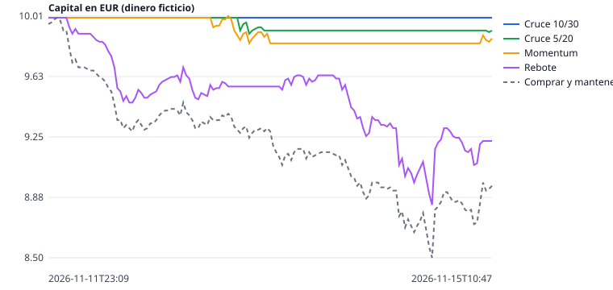

# Oficina de agentes (dinero ficticio)

Ultima actualizacion: 2026-11-19T19:47:46+00:00 UTC · Precio BTC/EUR: 56980 (Kraken)
En marcha desde: 2026-11-11T23:09:56+00:00 UTC (7.9 dias)
Monedas vigiladas: las 20 de mayor volumen contra EUR (con datos en esta ejecucion: 20) · cada agente puede tener hasta 2 a la vez, 5.00 EUR en cada una · los agentes de senales solo compran XBT, ETH
Sin agente principal: Tendencia H1 no paso la prueba historica (ver CRITERIOS.md y backtest_h1.md). Todos los agentes son exploratorios: que alguno gane puede ser casualidad.
Costes simulados por operacion: comision 0.40 % + deslizamiento 0.05 % (0.3 % en monedas de poco volumen) · limite de perdida diaria: 0.40 EUR

| Agente | Capital (EUR) | Resultado (EUR) | Resultado (%) | Dif. vs Comprar y mantener (EUR, desde su inicio) | Operaciones | Costes pagados (EUR) | Antes de costes (EUR) | Desde | Estado |
|---|---:|---:|---:|---:|---:|---:|---:|---|---|
| Cruce 10/30 | 9.10 | -0.90 | -8.97 % | +0.55 | 14 | 0.30 | -0.59 | 2026-11-11 | Con ETH, XBT |
| Cruce 5/20 | 8.91 | -1.09 | -10.86 % | +0.36 | 24 | 0.52 | -0.57 | 2026-11-11 | En efectivo |
| Momentum | 8.99 | -1.01 | -10.11 % | +0.44 | 20 | 0.43 | -0.58 | 2026-11-11 | En efectivo |
| Rebote | 9.32 | -0.68 | -6.82 % | +0.77 | 18 | 0.39 | -0.30 | 2026-11-11 | En efectivo |
| Cruce 10/30 + filtro | 10.00 | +0.00 | +0.00 % | +1.45 | 0 | 0.00 | +0.00 | 2026-11-11 | En efectivo |
| Cruce 3/8 rapido | 9.42 | -0.58 | -5.79 % | +0.87 | 10 | 0.22 | -0.36 | 2026-11-11 | En efectivo |
| Rebote rapido | 9.42 | -0.58 | -5.80 % | +0.87 | 22 | 0.49 | -0.09 | 2026-11-11 | Con ETH, XBT |
| Rebalanceo semanal | 8.84 | -1.16 | -11.57 % | +0.29 | 5 | 0.04 | -1.11 | 2026-11-11 | Con ADA, ETH, SOL, XBT, XRP |
| Tendencia H1 (diaria) | 10.00 | +0.00 | +0.00 % | +1.45 | 0 | 0.00 | +0.00 | 2026-11-11 | En efectivo |
| Comprar y mantener (solo BTC) | 8.55 | -1.45 | -14.50 % | 0.00 | 1 | 0.04 | -1.40 | 2026-11-11 | Referencia |
| Comprar y mantener (cesta) | 8.64 | -1.36 | -13.60 % | +0.09 | 2 | 0.04 | -1.31 | 2026-11-11 | Referencia: 2 monedas del inicio a partes iguales |
| Mantener la cesta del Rebalanceo | 8.84 | -1.16 | -11.57 % | +0.29 | 5 | 0.04 | -1.11 | 2026-11-11 | Referencia del Rebalanceo: sus 5 monedas sin rebalancear |

Rebalanceo semanal frente a mantener sus mismas 5 monedas sin rebalancear: +0.00 EUR (la columna «Dif. vs Comprar y mantener» lo compara solo con BTC).

Regla de Tendencia H1 (diaria) (ultimo cierre diario): ETH cierre del 2026-11-18 1618.38 frente a media de 100 dias 2087.21 (debajo: fuera); XBT cierre del 2026-11-18 57422.50 frente a media de 100 dias 68421.53 (debajo: fuera).

Riesgo (calculado con el historial guardado):

| Agente | Caida maxima | Operaciones ganadoras | Operaciones perdedoras |
|---|---:|---:|---:|
| Cruce 10/30 | -10.15 % | 0 | 6 |
| Cruce 5/20 | -11.10 % | 0 | 12 |
| Momentum | -10.19 % | 0 | 10 |
| Rebote | -11.70 % | 3 | 6 |
| Cruce 10/30 + filtro | 0.00 % | 0 | 0 |
| Cruce 3/8 rapido | -5.80 % | 0 | 5 |
| Rebote rapido | -6.50 % | 4 | 6 |
| Rebalanceo semanal | -16.10 % | 0 | 0 |
| Tendencia H1 (diaria) | 0.00 % | 0 | 0 |
| Comprar y mantener | -15.00 % | 0 | 0 |

Caida maxima = lo que llego a perder cada agente desde su mejor momento. Una operacion cuenta cuando se cierra con su venta.

⚠ Aun sin datos suficientes (se exigen 30 operaciones cerradas y 21 dias): Cruce 10/30 (6 cerradas, 8 dias); Cruce 5/20 (12 cerradas, 8 dias); Momentum (10 cerradas, 8 dias); Rebote (9 cerradas, 8 dias); Cruce 10/30 + filtro (0 cerradas, 8 dias); Cruce 3/8 rapido (5 cerradas, 8 dias); Rebote rapido (10 cerradas, 8 dias); Rebalanceo semanal (0 cerradas, 8 dias); Tendencia H1 (diaria) (0 cerradas, 8 dias). Antes de eso, el resultado puede ser pura suerte. El 9-feb-2027 (90 dias) el que no llegue a 30 cerradas se declara «no evaluable con esta muestra» (CRITERIOS.md, seccion 5).

Aviso: solo hay 7.9 dias de datos; aun no hay base para concluir que una estrategia sea mejor.

Una estrategia solo merece dinero real si supera de forma sostenida a 'Comprar y mantener' durante semanas.
Probar muchas monedas y estrategias aumenta la probabilidad de que alguna parezca buena solo por casualidad.
Estos resultados no garantizan beneficios futuros.
