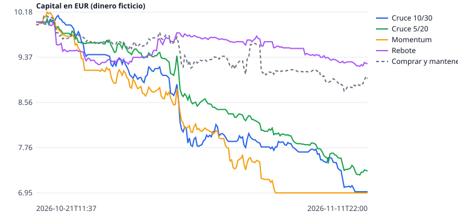

# Oficina de agentes (dinero ficticio)

Ultima actualizacion: 2026-11-10T17:43:15+00:00 UTC · Precio BTC/EUR: 65353 (Kraken)
En marcha desde: 2026-10-21T11:37:53+00:00 UTC (20.3 dias)
Monedas vigiladas: las 20 de mayor volumen contra EUR (con datos en esta ejecucion: 20) · cada agente puede tener hasta 5 a la vez, 2.00 EUR en cada una
Costes simulados por operacion: comision 0.40 % + deslizamiento 0.05 % (0.3 % en monedas de poco volumen) · limite de perdida diaria: 0.40 EUR

| Agente | Capital (EUR) | Resultado (EUR) | Resultado (%) | Dif. vs Comprar y mantener (EUR, desde su inicio) | Operaciones | Desde | Estado |
|---|---:|---:|---:|---:|---:|---|---|
| Cruce 10/30 | 7.05 | -2.95 | -29.45 % | -1.71 | 115 | 2026-10-21 | Con AAVE, EURC, XDC |
| Cruce 5/20 | 7.35 | -2.65 | -26.46 % | -1.41 | 152 | 2026-10-21 | Con AAVE, PEPE, TIA, UNI |
| Momentum | 6.95 | -3.05 | -30.53 % | -1.82 | 148 | 2026-10-21 | Apagado por riesgo |
| Rebote | 9.27 | -0.73 | -7.28 % | +0.51 | 65 | 2026-10-21 | Con COMP, ETH, TRUMP, W, WLD |
| Cruce 10/30 + filtro | 7.43 | -2.57 | -25.75 % | -1.34 | 84 | 2026-10-21 | Con EURC, PEPE, VVV, XDC |
| Consenso 2 de 3 | 6.94 | -3.06 | -30.57 % | -1.82 | 196 | 2026-10-21 | Apagado por riesgo |
| Cruce 3/8 rapido | 8.39 | -1.61 | -16.09 % | -0.37 | 140 | 2026-10-21 | En efectivo |
| Momentum rapido | 6.95 | -3.05 | -30.47 % | -1.81 | 318 | 2026-10-21 | Apagado por riesgo |
| Rebote rapido | 7.01 | -2.99 | -29.89 % | -1.75 | 204 | 2026-10-21 | Con ETH, LSK, WLD, XMR |
| Comprar y mantener (solo BTC) | 8.77 | -1.23 | -12.34 % | 0.00 | 1 | 2026-10-21 | Referencia |

Riesgo (calculado con el historial guardado):

| Agente | Caida maxima | Operaciones ganadoras | Operaciones perdedoras |
|---|---:|---:|---:|
| Cruce 10/30 | -30.34 % | 9 | 47 |
| Cruce 5/20 | -26.94 % | 8 | 66 |
| Momentum | -31.73 % | 14 | 60 |
| Rebote | -7.60 % | 14 | 16 |
| Cruce 10/30 + filtro | -26.58 % | 5 | 35 |
| Consenso 2 de 3 | -31.29 % | 9 | 89 |
| Cruce 3/8 rapido | -16.43 % | 15 | 55 |
| Momentum rapido | -31.93 % | 36 | 123 |
| Rebote rapido | -29.90 % | 21 | 79 |
| Comprar y mantener | -13.25 % | 0 | 0 |

Caida maxima = lo que llego a perder cada agente desde su mejor momento. Una operacion cuenta cuando se cierra con su venta.

⚠ Aun sin datos suficientes (se exigen 30 operaciones cerradas y 21 dias): Cruce 10/30 (56 cerradas, 20 dias); Cruce 5/20 (74 cerradas, 20 dias); Momentum (74 cerradas, 20 dias); Rebote (30 cerradas, 20 dias); Cruce 10/30 + filtro (40 cerradas, 20 dias); Consenso 2 de 3 (98 cerradas, 20 dias); Cruce 3/8 rapido (70 cerradas, 20 dias); Momentum rapido (159 cerradas, 20 dias); Rebote rapido (100 cerradas, 20 dias). Antes de eso, el resultado puede ser pura suerte.

Aviso: solo hay 20.3 dias de datos; aun no hay base para concluir que una estrategia sea mejor.

Una estrategia solo merece dinero real si supera de forma sostenida a 'Comprar y mantener' durante semanas.
Probar muchas monedas y estrategias aumenta la probabilidad de que alguna parezca buena solo por casualidad.
Estos resultados no garantizan beneficios futuros.
